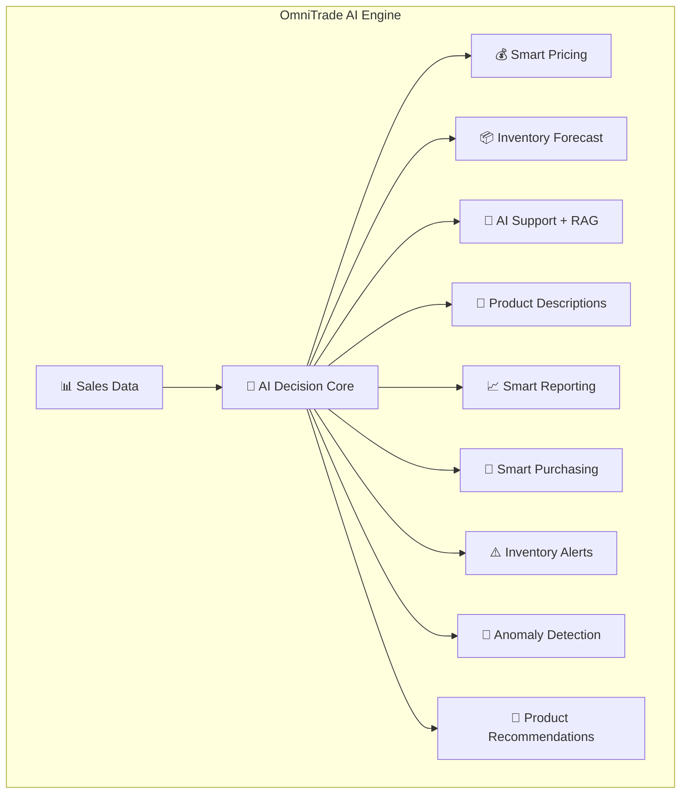

# 🌍 OmniTrade ERP — AI-Native Cross-Border E-commerce ERP

<div align="center">

[](https://www.oracle.com/java/)
[](https://spring.io/projects/spring-boot)
[](https://vuejs.org/)
[](LICENSE)
[](https://github.com/nplszfl/OmniTradeERP/stargazers)
[](https://github.com/nplszfl/OmniTradeERP/network)
[](https://github.com/nplszfl/OmniTradeERP/commits/master)

**中文文档** · [📖 Full Docs](docs/Home.md) · [🚀 Quick Start](#-quick-start)

</div>

---

<div align="center">

## 🔥 Code ignites the cross-border e-commerce road

### "The most hardcore open-source ERP for cross-border sellers you'll ever see"

[📖 Documentation](docs/Home.md) · [💬 Community](#-community) · [🚀 Quick Start](#-quick-start)

</div>

---

## ⭐ Why OmniTrade ERP?

| Your pain point | How we solve it |
|---|---|
| 🏪 **Too many platforms to juggle** | Amazon, eBay, Shopee, Lazada, TikTok Shop… one backend for 10+ marketplaces |
| 📊 **Manual repricing every day** | 🤖 AI pricing — monitors competitors, optimizes price, targets +15% margin |
| 📦 **Inventory forecasting by guesswork** | 📈 Trend forecasting (moving average + trend + seasonality) + smart reorder suggestions |
| 💬 **Customer support in five languages** | 🌍 AI assistant with RAG knowledge base + LLM, 7×24 auto-replies |
| 💰 **Commercial ERPs are expensive** | 🆓 Fully open source, MIT license, no vendor lock-in |

> ⚡ **100k+ orders/day, 5000+ QPS per node — this is what production-grade means**

---

## 🏆 Why not the alternatives?

| | OmniTrade ERP | Typical OSS A | Typical OSS B |
|---|---|---|---|
| **AI services** | 🤖 9 AI services built in | ❌ None | ❌ None |
| **Marketplaces** | 10+ and growing | 3-5 | 2-3 |
| **Stack** | Java 21 + Vue 3 + Spring Cloud | Java 8 + Vue 2 | Python + Django |
| **Architecture** | ✅ Full microservice (Nacos/Sentinel/Gateway) | ⚠️ Monolith | ❌ None |
| **Deployment** | Docker / K8s / bare metal | Docker only | Manual |
| **Tests** | 100+ unit tests | A few | None |
| **License** | MIT (commercial use OK) | GPL-restricted | AGPL-restricted |
| **Maintenance** | 🟢 Daily commits | 🟡 Every 6 months | 🔴 Dead |

---

## 🧠 AI-Native Architecture



### 🤖 The 9 AI services

| Service | What it does | Port |
|---|---|---|
| **Pricing** | Competitor scraping → cost-plus & target-margin pricing with seasonal/stock/demand factors | 8087 |
| **Inventory Prediction** | Trend forecast + reorder suggestions + low-stock / overstock alerts | 8088 |
| **AI Assistant** | RAG knowledge base + intent routing + multilingual streaming replies | 8089 |
| **Product Description** | SEO-optimized descriptions, batch generation, per-marketplace styles | 8091 |
| **Reporting** | Daily/weekly/monthly reports + Excel export + multi-dimensional analysis | 8098 |
| **Purchasing** | Purchase forecasting, supplier quote comparison, purchase plans | 8093 |
| **Inventory Alert** | Slow-moving SKU detection, low-stock and overstock warnings | 8086 |
| **Anomaly Detection** | Rule engine + AI scoring, two-layer fusion for order anomalies | 8138 |
| **Product Recommendation** | Multi-factor weighted scoring + trend forecast + risk assessment | 8139 |

**Every AI result is persisted** — pricing runs, forecast snapshots, SEO scores, highlight
extractions and A/B test outcomes are all queryable history, not throwaway responses.

---

## 🏗️ Architecture

```
┌─────────────────────────────────────────────────────────────────┐
│                      Nginx / Load Balancer                       │
└─────────────────────────────────────────────────────────────────┘
                                 │
                                 ▼
┌─────────────────────────────────────────────────────────────────┐
│                   API Gateway (:8080)                           │
│                    Spring Cloud Gateway                         │
└─────────────────────────────────────────────────────────────────┘
        │              │            │              │              │
        ▼              ▼            ▼              ▼              ▼
   ┌─────────┐   ┌─────────┐  ┌─────────┐   ┌─────────┐   ┌─────────┐
   │ Order   │   │ Product │  │Platform │   │  User   │   │ Pricing │
   │ Service │   │ Service │  │ Service │   │ Service │   │ Service │
   └─────────┘   └─────────┘  └─────────┘   └─────────┘   └─────────┘
        │              │            │              │              │
        └──────────────┴────────────┴──────────────┴──────────────┘
                                 │
        ┌────────────────────────┼────────────────────────┐
        ▼                        ▼                        ▼
   ┌─────────┐           ┌─────────────┐           ┌─────────┐
   │  MySQL  │           │   Redis     │           │ RocketMQ │
   └─────────┘           └─────────────┘           └─────────┘
```

### Tech stack

| Layer | Technology | Version |
|------|------------|---------|
| Framework | Spring Boot | 3.3.5 |
| Microservices | Spring Cloud | 2024.0.1 |
| Cloud Native | Spring Cloud Alibaba | 2024.0.0 |
| Runtime | Java | 21 (virtual threads) |
| ORM | MyBatis-Plus | 3.5.6 |
| Registry / Config | Nacos | 2.4+ |
| Traffic Control | Sentinel | 1.8+ |
| Gateway | Spring Cloud Gateway | — |
| Database | MySQL | 8.0+ |
| Cache | Redis | — |
| Messaging | RocketMQ | — |
| Frontend | Vue 3 + TypeScript | — |
| UI / Charts | Element Plus / ECharts | — |

---

## 🚀 Quick Start

### Option 1: Docker Compose (recommended ⭐)

```bash
# Clone
git clone https://github.com/nplszfl/OmniTradeERP.git
cd OmniTradeERP

# ⚠️ **Generate your own local secret first**
#    (the repo ships **no default values** — a public default would mean
#     "everyone shares the same key" and anyone could forge an admin token)
cp .env.example .env
echo "JWT_SECRET=$(openssl rand -base64 32)" >> .env

# One-command start (minimal mode, ~4GB RAM)
docker-compose -f docker-compose.minimal.yml up -d

# Access
# Frontend : http://localhost
# Backend  : http://localhost:8080
# Nacos    : http://localhost:8848  (nacos / nacos)
```

### Option 2: Kubernetes

```bash
chmod +x smart-deploy.sh && ./smart-deploy.sh
```

### Option 3: Local development

```bash
mvn clean install -DskipTests
mvn spring-boot:run -pl erp-web
```

---

## 📦 Project structure

```
OmniTradeERP/
├── erp-gateway/                # API gateway (:8080)
├── erp-order-service/          # Orders (:8081)
├── erp-platform-service/       # Marketplace APIs (:8082)
├── erp-product-service/        # Products (:8083)
├── erp-user-service/           # Users & auth (:8084)
├── erp-inventory-service/      # Inventory (:8094)
├── erp-warehouse-service/      # Warehousing (:8092)
├── erp-finance-service/        # Finance (:8090)
│
│ # 🤖 AI services
├── erp-pricing-service/        # Smart pricing (:8087)
├── erp-inventory-prediction-service/   # Forecast (:8088)
├── erp-ai-assistant-service/   # AI support + RAG (:8089)
├── erp-product-description-service/     # Descriptions (:8091)
├── erp-reporting-service/      # Reporting (:8098)
├── erp-purchase-service/       # Smart purchasing (:8093)
├── erp-inventory-alert-service/# Inventory alerts (:8086)
├── erp-anomaly-detection-service/  # Anomaly detection (:8138)
├── erp-product-recommendation-service/  # Recommendations (:8139)
│
├── erp-web/                    # Vue 3 frontend
├── database/                   # SQL init scripts
├── docker/                     # Docker configs
└── k8s/                        # Kubernetes manifests
```

---

## 🌍 Supported marketplaces

| Marketplace | Status | Marketplace | Status |
|------|------|------|------|
| 🛍️ Amazon | ✅ Done | 🎵 TikTok Shop | ✅ Done |
| 🛒 eBay | ✅ Done | 📦 Temu | 🔜 Planned |
| 🛍️ Shopee | ✅ Done | 🌐 AliExpress | 🔜 Planned |
| 🛒 Lazada | ✅ Done | 👗 SHEIN | 🔜 Planned |

---

## 🧪 Quality gates

This repo runs **81 automated quality gates** on every push — they are the reason the
codebase stays honest:

- No mock/stub code in `src/main` (tests are the only place Mockito is allowed)
- No "DDL exists but nothing writes to it" — every table has a real write path
- No silently-failing endpoints — a failed write must raise, not pretend
- No dangling references — every new gate is wired into CI in the same commit

Run them locally:

```bash
for f in scripts/check-*.py; do python3 "$f" || echo "FAILED: $f"; done
```

---

## 📊 Performance

| Metric | Value | Notes |
|------|-------|-------|
| ⚡ Orders/day | 100k+ | Horizontally scalable |
| 🚀 QPS per node | 5000+ | Java 21 virtual threads |
| ⏱️ Avg latency | <200ms | P99 |
| 🛡️ Availability | 99.9% | K8s HA |

> Performance figures are architectural targets from load modeling, **not** results from a
> public production deployment. Validate against your own workload before relying on them.

---

## 🤝 Contributing

Contributions are welcome — see [CONTRIBUTING.md](CONTRIBUTING.md).

```bash
git clone https://github.com/YOUR_USERNAME/OmniTradeERP.git
git checkout -b feature/your-feature
mvn test
```

**Code conventions**
- Follow Google Java Style Guide
- Every new public method needs Javadoc that explains *why*, not just *what*
- New features need unit tests
- `mvn test` must pass before you push

---

## 📄 License

[MIT](LICENSE) — free for commercial use, modification and redistribution.

---

## 💬 Community

- 🐛 [Report a bug](https://github.com/nplszfl/OmniTradeERP/issues/new?template=bug_report.yml)
- 💡 [Request a feature](https://github.com/nplszfl/OmniTradeERP/issues/new?template=feature_request.yml)
- 💬 [Ask a question](https://github.com/nplszfl/OmniTradeERP/discussions)
- 📣 [Changelog & releases](https://github.com/nplszfl/OmniTradeERP/releases)

---

<div align="center">

**Made with ☕ by the OmniTrade ERP contributors**

⭐ If this project helps your business, please **star it** — it directly decides how
much investment this project gets next.

</div>
